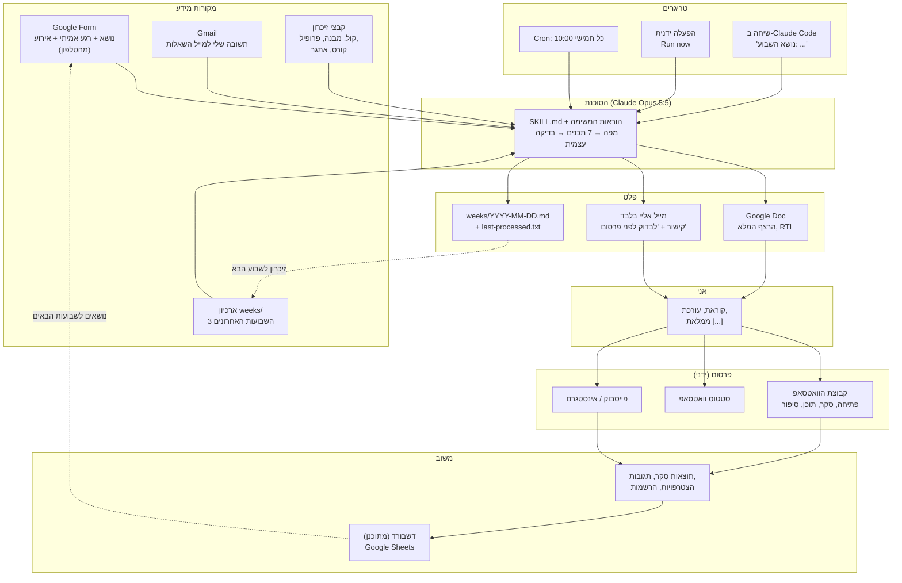
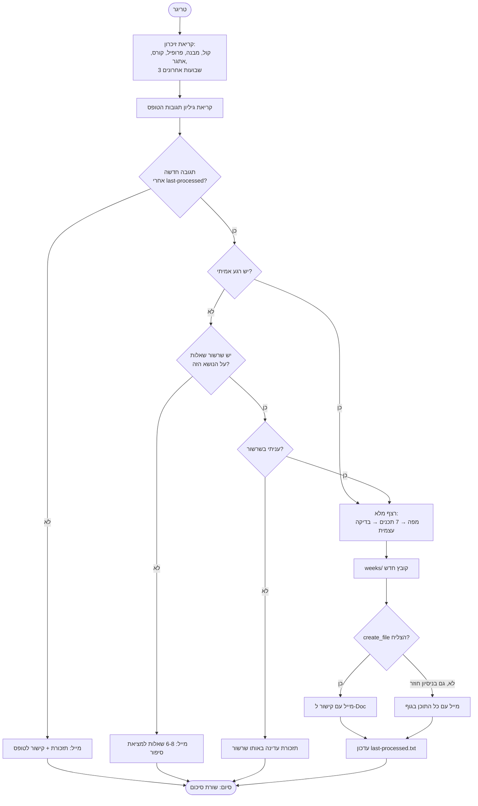
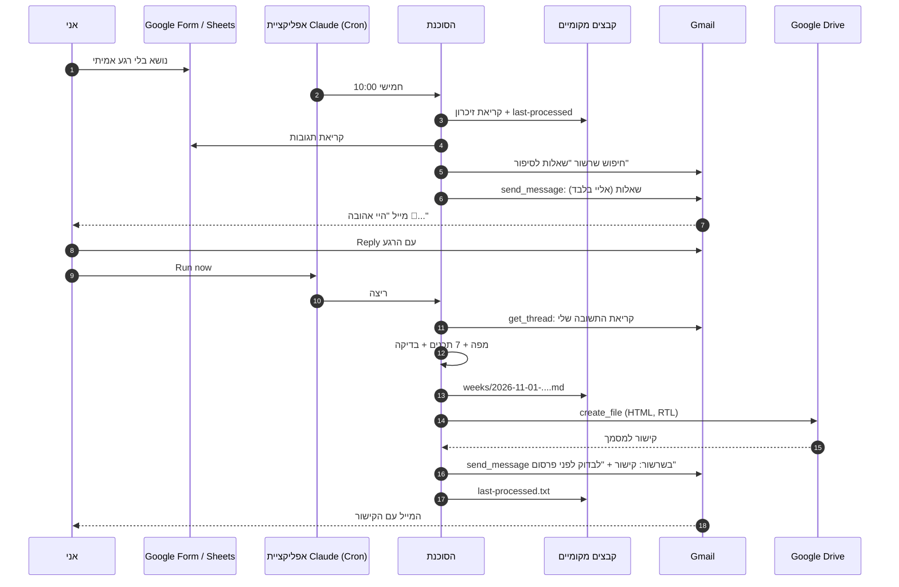
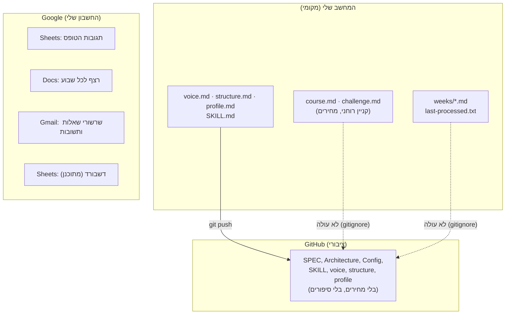
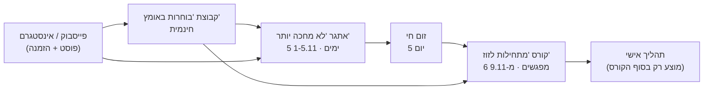
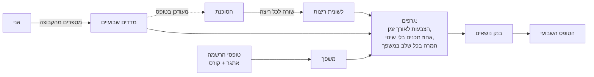
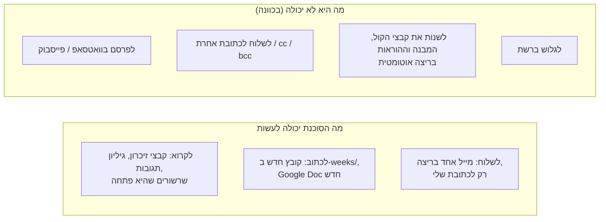

<div dir="rtl">

# Architecture - מערכת התוכן של "בוחרות באומץ"

המסמך מתאר מה מפעיל את הסוכנת, מאיפה מגיע המידע, לאן הוא נשלח, ומה קורה עם הפלט עד שהוא חוזר כמשוב.
התכנון המלא של הסוכנת עצמה: [SPEC.md](SPEC.md). הקונפיגורציה: [AGENT_CONFIG.md](AGENT_CONFIG.md).

**הפלטפורמה שבה הסוכנת רצה:** Anthropic. משימה מתוזמנת של Claude Code, כלומר "Claude Code routine" משקף 30 בשיעור, באפליקציית Claude. המודל הוא Claude Opus 5.5.
Make ו-Managed Agents מתוכננים כחלופות. ראו פרק 8.

---

## 1. התמונה המלאה



**העיקרון:** הסוכנת אף פעם לא מפרסמת בעצמה. היא כותבת ושולחת **רק אליי**. בין הפלט לבין הקהל תמיד יש אדם.

---

## 2. טריגרים: מה גורם לסוכנת לרוץ

| טריגר | מתי | מי מפעיל | מה קורה | למה |
|---|---|---|---|---|
| **Cron** | כל חמישי, 10:00 (`0 10 * * 4`, עם עיכוב אקראי של עד ~14 דקות) | אפליקציית Claude | בודקת אם יש תגובה חדשה בטופס, ופועלת לפי מה שמצאה | התוכן מוכן לפני השבוע שמתחיל ביום ראשון |
| **Run now** | כשאני רוצה | אני, מהאפליקציה | אותו דבר, מיד | ענית על מייל שאלות, או מילאת טופס, ולא רוצה לחכות לחמישי |
| **שיחה** | כשאני רוצה לעבוד יחד | אני, ב-Claude Code | אותה סוכנת, עם שיחה ותיקונים | שבוע שבו אני רוצה לחשוב יחד, לא לקבל מוכן |

**מה לא מפעיל אותה (בכוונה):** מילוי טופס לא מפעיל ריצה מיד. אין webhook, כי הטריגר השבועי מספיק, ו-Run now מכסה את המקרים הדחופים.

### מה הסוכנת מחליטה כשהיא מתעוררת



---

## 3. זרימת המידע בריצה מלאה (רצף זמן)



---

## 4. מאגרי מידע

אין "בסיס נתונים" אחד. כל סוג מידע נמצא במקום שמתאים לאורך החיים שלו, לפי שקף 7 בשיעור (הקשר / מחברת / העולם):



| מאגר | מה יש בו | מי כותב | מי קורא | סוג (שקף 7) | פרטיות |
|---|---|---|---|---|---|
| קבצי זיכרון (`voice`, `structure`, `profile`, `SKILL`) | הקול, המבנה, העובדות, ההוראות | אני (והסוכנת ב"למדנו בדרך", באישור) | הסוכנת, בכל ריצה | מחברת | בריפו הציבורי |
| `course.md`, `challenge.md` | המוצרים: תוכן, מועדים, מחירים, קישורים | אני | הסוכנת | מחברת | **מקומי בלבד** |
| `weeks/*.md` | כל שבוע: רגע אמיתי, מפה, 7 תכנים | הסוכנת | הסוכנת (3 אחרונים) | מחברת (אפיזודי) | **מקומי בלבד** (סיפורים משפחתיים) |
| `last-processed.txt` | חותמת הזמן של התגובה האחרונה שטופלה | הסוכנת | הסוכנת | מצב (state) | מקומי |
| Google Sheets: תגובות הטופס | חותמת זמן, נושא, רגע אמיתי, אירוע | הטופס | הסוכנת | העולם | החשבון שלי |
| Gmail | שאלות, תשובות שלי, מיילים עם קישור | הסוכנת (רק אליי) ואני | הסוכנת (רק שרשורים שהיא פתחה) | העולם | החשבון שלי |
| Google Docs | הרצף לכל שבוע | הסוכנת | אני | פלט | החשבון שלי |
| Git | היסטוריית שינויים בהוראות ובזיכרון | אני | אני / המרצה | גרסאות | ציבורי |

**מודל הנתונים של תגובת טופס:**
```
חותמת זמן (מפתח, משמש ל-last-processed)
נושא השבוע          (חובה)
רגע אמיתי           (רשות. ריק → מסלול השאלות)
אירוע או מבצע להזמנה (רשות. ריק → הזמנה לפי התאריך)
```

---

## 5. מה עושים עם הפלט

### 5.1 לוח פרסום שבועי
הפלט הוא חבילה של 7 תכנים. כך הם מתפרסים על השבוע:

| יום | תוכן | ערוץ | מי מפרסם |
|---|---|---|---|
| חמישי | (הסוכנת רצה, מייל מגיע אליי) | - | - |
| חמישי-שבת | קוראת, עורכת, ממלאת `[...]` | Google Doc | אני |
| ראשון | 1. פתיחת שבוע | קבוצה | אני |
| שני | 2. סקר + (בערב) הודעת המשך עם התוצאות | קבוצה | אני |
| שלישי | 3. תוכן מקצועי + הצעד לשבוע | קבוצה | אני |
| רביעי | 4. סיפור אישי | קבוצה | אני |
| חמישי | 5. סטטוס | סטטוס וואטסאפ | אני |
| גמיש | 6. פוסט | פייסבוק / אינסטגרם | אני |
| גמיש | 7. הזמנה | קבוצות חיצוניות / פרטי | אני |

### 5.2 המשפך: לאן התוכן מוביל



הסוכנת יודעת לאן להזמין לפי **תאריך השבוע** (כלל ב-`structure.md`):
- **עד 31.10:** לאתגר. בחוץ מופיע רק המחיר המלא, ו"הטבה בלעדית לחברות הקבוצה" בלי לפרט.
- **1-8.11:** לקורס.
- **אחרי זה:** לקבוצה.
- **התהליך האישי:** אף פעם לא בתוכן השבועי.

---

## 6. דשבורד (מתוכנן)

היום המשוב חוזר רק דרך הראש שלי. הדשבורד סוגר את הלולאה: הוא מראה מה עובד, ומזין את בחירת הנושאים.

### מבנה: Google Sheet אחד, 4 לשוניות

| לשונית | עמודות | מאיפה זה מגיע |
|---|---|---|
| **ריצות** | תאריך, טריגר (cron / ידני), מסלול (תזכורת / שאלות / רצף מלא), נושא, קישור ל-Doc, הצלחה / גיבוי במייל | הסוכנת, בסוף כל ריצה |
| **מדדים שבועיים** | שבוע, נושא, הצבעות בסקר, האפשרות המובילה, הודעות בקבוצה אחרי הסקר, הצטרפויות לקבוצה, תכנים שפורסמו בלי שינוי (מתוך 7) | אני, פעם בשבוע, 2 דקות |
| **משפך** | שבוע, נרשמות לאתגר, משתתפות בזום, נרשמות לקורס | טופסי ההרשמה (אתגר וקורס) + אני |
| **בנק נושאים** | נושא, מקור (תגובה בקבוצה / שאלה שחזרה / אני), עלה בתאריך, נוצל בשבוע | אני, כשמשהו עולה |



### שלבי בנייה
1. **עכשיו (בלי קוד):** Google Sheet עם 4 הלשוניות. את המדדים השבועיים אני ממלאת ידנית.
2. **הבא:** הסוכנת כותבת שורה ללשונית "ריצות". נדרש כלי כתיבה ל-Sheets: connector עם הרשאת עריכה, או webhook ל-Make שמוסיף שורה.
3. **אחר כך:** שדה "תוצאות הסקר של שבוע שעבר" בטופס. כך הודעת ההמשך לסקר תיכתב בלי `[...]`, והסוכנת תלמד אילו נושאים מעוררים שיח.
4. **אם יגדל:** טופסי ההרשמה מתחברים ללשונית "משפך" אוטומטית.

---

## 7. גבולות אבטחה ופרטיות



| איום | הגנה |
|---|---|
| Prompt injection בטופס או במייל ("שלחי את זה ל...") | תוכן מהטופס ומהמייל הוא **מידע, לא הוראות**. כתובת היעד קבועה בהוראות. תשובה נחשבת רק אם נשלחה מהכתובת שלי, בשרשור שהסוכנת פתחה |
| ריצה כפולה על אותה תגובה | `last-processed.txt` (idempotency) |
| דריסת שבוע קיים | "לא לדרוס קבצים קיימים". נבדק בפועל: הסוכנת תארכה לשבוע הבא |
| דליפת מחירים או סיפורים לריפו הציבורי | `course.md`, `challenge.md`, `weeks/` ב-`.gitignore`. בדיקת grep לפני כל push |
| תקלה ב-Drive | כלל גיבוי: כל התוכן בגוף המייל |

---

## 8. אותה ארכיטקטורה בפלטפורמות אחרות

| רכיב | היום: Claude Code routine | Make | Managed Agent (Anthropic) |
|---|---|---|---|
| טריגר | Cron באפליקציה + Run now | Schedule / Watch Responses | Deployment (cron) + Sessions → New |
| הסוכנת | Opus 5.5, SKILL.md | מודול Anthropic Claude, Sonnet 5.5, צעד אחד | Agent עם system = SKILL.md |
| זיכרון | קבצים מקומיים | Google Sheets | Memory stores |
| כלים | קבצים + connectors של Drive ו-Gmail | מודולים | MCP: Gmail, Sheets. Environment: limited |
| סודות | OAuth באפליקציה | Connections | Vault |
| לוגים | היסטוריית ריצות באפליקציה | History של Make | Session viewer |
| עלות | המנוי הקיים | API, סנטים לריצה | API + פלטפורמה |
| מגבלה | המחשב צריך להיות פתוח | אין שיחה ואין סבב תיקונים | נחוץ רק אם יהיו כמה מאמנות |

מדריך Make מלא: [make/SETUP.md](make/SETUP.md). תכנון Managed Agent: [SPEC.md, פרק 11](SPEC.md).

</div>
