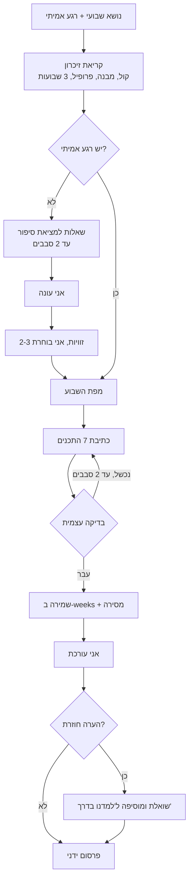
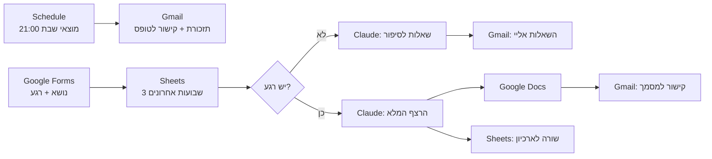

<div dir="rtl">

# SPEC - סוכנת התוכן של "בוחרות באומץ"

מסמך תכנון לסוכן AI שמייצר רצף תוכן שבועי לקהילת וואטסאפ של מאמנת מנטלית לנשים.

| | |
|---|---|
| **בעלת המוצר** | אפרת-יערה, מאמנת מנטלית לנשים |
| **סטטוס** | גרסה 1 פועלת (Claude Code). גרסאות 2-3 בתכנון (Make, Managed Agent) |
| **תאריך** | אוקטובר 2026 |

**הסוכנת בשורה אחת** (לפי הנוסחה מהשיעור):
מודל (Claude) שמשתמש בכלים (קריאה וכתיבה של קבצים) ושומר זיכרון (הקול, המבנה, ארכיון שבועי), כדי לבנות רצף תוכן שבועי שלם (המטרה), בתוך לולאה של שאלה, כתיבה, בדיקה ותיקון, עד שהרצף מוכן.

---

## 1. הבעיה

אני מנהלת קהילת וואטסאפ חינמית בשם "בוחרות באומץ", לנשים שרוצות שינוי אבל מתקשות לבחור בעצמן ולעשות את הצעד בגלל פחד לאכזב, ריצוי, אשמה או חוסר ביטחון בהחלטות.

כל שבוע אני צריכה לייצר כ-7 תכנים שונים סביב נושא אחד: לקבוצה, לסטטוס, לפייסבוק ולהזמנת חברות חדשות. הבעיות:

- **זמן:** כתיבת 7 תכנים שונים לוקחת שעות.
- **רצף:** קשה לשמור שהתכנים יתחברו זה לזה ויובילו מהזיהוי אל הצעד, ולא יהיו 7 פוסטים נפרדים.
- **קול:** כלי AI כלליים כותבים בשפה "מאמנתית", עם קלישאות העצמה ("את לא לבד", "מגיע לך יותר"), וזה לא הקול שלי.
- **אמת:** כלי AI נוטים להמציא סיפורים אישיים. אצלי כל סיפור חייב להיות אמיתי.
- **חזרות:** אחרי כמה שבועות קל לחזור על אותן פתיחות ושאלות.
- **מעורבות:** בקבוצה מעט מגיבות בכתב. סקרים עובדים טוב יותר ופותחים שיח.

## 2. למה סוכן, ולא קריאה אחת או תהליך קבוע?

לפי השיעור: סוכן נחוץ רק כשאי אפשר לרשום את הצעדים מראש.

| אפשרות | מתאים? | למה |
|---|---|---|
| **קריאה אחת** ("כתוב לי 7 פוסטים על X") | לא | אין זיכרון של הקול ושל שבועות קודמים, אין בדיקה עצמית, והמודל ימציא סיפור |
| **תהליך קבוע (Workflow)** | חלקית | ההפעלה והמסירה (טופס → מייל) הן צעדים קבועים, ולכן Make מתאים להן (גרסה 2). הכתיבה עצמה לא |
| **סוכן** | כן | הצעדים תלויים במצב: אם אין סיפור היא שואלת שאלות, אם חסר פרט היא עוצרת, אם בדיקה נכשלת היא מתקנת. היא גם קוראת שבועות קודמים ומחליטה מה לא לחזור עליו |

**ארבע הבדיקות מהשיעור:**

| בדיקה | תשובה |
|---|---|
| האם זו משימה רב-שלבית שקשה להגדיר מראש? | כן. מציאת סיפור, מפה, 7 תכנים, בדיקה ותיקון. המסלול משתנה משבוע לשבוע |
| האם זה שווה את העלות? | כן. ריצה אחת בשבוע, עלות של סנטים עד דולר בודד, וחוסכת שעות |
| האם Claude יודע לעשות את זה? | כן. כתיבה בעברית לפי הנחיות סגנון. נבדק בריצה אמיתית (פרק 12) |
| האם אפשר לתפוס טעות ולתקן? | כן. שום דבר לא מתפרסם בלי שאני קוראת ומאשרת |

## 3. מטרה ומדדי הצלחה

מנושא שבועי אחד ומרגע אמיתי אחד, לייצר רצף שלם של 7 תכנים מוכנים להעתקה, בקול שלי, במבנה קבוע של **זיהוי → הבנה → בחירה → צעד**, בלי להמציא פרטים ובלי לחזור על שבועות קודמים.

| מדד | יעד |
|---|---|
| זמן הכנת תוכן שבועי | מכ-3 שעות לפחות מ-45 דקות (כולל עריכה שלי) |
| תכנים שעוברים כמעט בלי שינוי | 5 מתוך 7 |
| פרטים מומצאים | 0 |
| ביטויים אסורים | 0 |
| הצבעות בסקר השבועי | מעקב שבועי, מגמה עולה |
| הודעות בקבוצה אחרי הסקר | מעקב שבועי |
| הצטרפויות חדשות מהודעת ההזמנה | מעקב שבועי |

### היקף
**הסוכנת כן:** בונה מפת שבוע, עוזרת לי למצוא סיפור אמיתי, כותבת 7 תכנים, בודקת את עצמה, שומרת ארכיון ולומדת מהערות שלי.

**הסוכנת לא:**
- **לא מפרסמת בעצמה.** הפרסום בוואטסאפ ובפייסבוק נשאר ידני. זו החלטה מכוונת: כל תוכן עובר את העיניים שלי לפני שהוא מגיע לנשים אמיתיות. בנוסף, ה-API של WhatsApp Business לא תומך בפרסום לקבוצות.
- לא ממציאה סיפורים, אנשים, ציטוטים, מספרים או "מחקרים".
- לא עונה לחברות בקבוצה ולא מנהלת שיחות אימון.

---

# חלק א' - חמשת הרכיבים

## 4. המודל (המוח)

| | |
|---|---|
| **מודל** | Claude Opus 5.5 (גרסה 1, ב-Claude Code). Claude Sonnet 5.5 (גרסה 2, ריצה אוטומטית ב-Make, זול יותר) |
| **למה** | כתיבה טובה בעברית, עמידה בהנחיות סגנון מורכבות ושיקול דעת: מתי לשאול, מתי לעצור |
| **מה הוא מחליט** | איזה שלב עכשיו, אילו שאלות לשאול כדי למצוא סיפור, איך לבנות את המפה, מה לא לחזור עליו מהשבועות הקודמים, האם הטקסט עבר את הבדיקה |
| **מה הוא לא יכול** | לזכור שבוע קודם בלי לקרוא קובץ, לפרסם, לדעת מה קרה לי אם לא סיפרתי |

## 5. המטרה (הוראות התפקיד)

ההוראות נמצאות ב-[`SKILL.md`](.claude/skills/bocharot-beometz/SKILL.md), בנויות לפי התבנית מהשיעור:

| חלק | מה כתוב |
|---|---|
| **WHO** | סוכנת תוכן של קהילת "בוחרות באומץ", כותבת בקול של המאמנת |
| **STEPS** | 0. קריאת זיכרון → 0.5. מציאת סיפור (אם צריך) → 1. מפת שבוע → 2. כתיבת 7 תכנים → 3. בדיקה עצמית → 4. מסירה ושמירה |
| **RULES** | לא ממציאה פרטים. ביטויים אסורים. לא מפרסמת. לא מוחקת קבצים קודמים |
| **DONE** | מפה של 4 שורות + 7 תכנים שעברו בדיקה + קובץ שמור ב-`weeks/` + שורה של "מה חסר ומה לבדוק" |
| **כשלא בטוחה** | חסר פרט: שואלת. תוכן רגיש: מסמנת לבדיקה. בקשה שסותרת כלל: עושה ושואלת אם לעדכן את הכלל |
| **אסור לגעת** | קבצים קודמים בארכיון, `profile.md` ו-`structure.md` (רק בבקשה מפורשת), שום פעולת פרסום |

### המבנה שהסוכנת בונה כל שבוע
**מפת השבוע** (4 שורות שכל התכנים נגזרים מהן, וזה מה שהופך 7 טקסטים לרצף אחד):
- **זיהוי:** מה היא מרגישה ועושה ביומיום.
- **הבנה:** מה קורה מתחת (ריצוי, פחד לאכזב, אשמה, חוסר ביטחון).
- **בחירה:** מה האפשרות האחרת.
- **צעד:** פעולה אחת קטנה וקונקרטית, פחות מ-10 דקות.

**הפלט:**

| # | תוכן | שלב בקשת | ערוץ | אורך |
|---|---|---|---|---|
| 1 | פתיחת שבוע | זיהוי | קבוצה | 50-90 מילים |
| 2 | סקר + הודעת המשך | זיהוי → הבנה | קבוצה (סקר וואטסאפ) | שאלה + 3-4 תשובות |
| 3 | תוכן מקצועי + הצעד לשבוע | הבנה | קבוצה | 100-170 מילים |
| 4 | סיפור אישי | הבנה → בחירה | קבוצה | 120-200 מילים |
| 5 | סטטוס (3 גרסאות) | בחירה | סטטוס וואטסאפ | 1-3 שורות |
| 6 | פוסט לפייסבוק | כל הקשת | פייסבוק | 120-200 מילים |
| 7 | הודעת הזמנה | צעד | קבוצות / פרטי | 60-110 מילים |

הפירוט המלא של כל תוכן: [`structure.md`](.claude/skills/bocharot-beometz/structure.md).

## 6. הכלים (הידיים)

המודל לא מפעיל כלים בעצמו. הוא מבקש, והסביבה (Claude Code, Make או הפלטפורמה) מריצה ומחזירה תוצאה.

### גרסה 1 - Claude Code

| כלי | מה הוא עושה | קלט | הרשאה | סיכון |
|---|---|---|---|---|
| `read` | קורא קובץ זיכרון או שבוע קודם | נתיב קובץ | אוטומטי | אין, קריאה בלבד |
| `glob` | מוצא את 3 השבועות האחרונים | תבנית `weeks/*.md` | אוטומטי | אין |
| `write` | שומר קובץ שבוע חדש | נתיב + תוכן | אוטומטי, רק לקובץ חדש ב-`weeks/` | נמוך. לא דורס קבצים קיימים |
| `edit` | מוסיף שורה ל"למדנו בדרך" ב-`voice.md` | טקסט להוספה | **שואלת קודם** | בינוני. משנה את ההתנהגות של כל השבועות הבאים |
| שאלה למשתמשת | עוצרת ושואלת (סיפור, פרט חסר) | שאלה | - | אין |
| `web_search` / `web_fetch` | - | - | **כבוי** | הסוכנת לא צריכה רשת. כבוי מונע "מחקרים" מומצאים ו-prompt injection מדפים |

### גרסה 2 - Make (תהליך סביב הסוכנת)

| כלי | תפקיד | הרשאה |
|---|---|---|
| Google Forms | קלט: נושא, רגע, אירוע | קריאה |
| Google Sheets | ארכיון: קריאת 3 שבועות, הוספת שורה | קריאה + הוספה בלבד |
| Anthropic Claude | הכתיבה | - |
| Google Docs | יצירת מסמך שבועי | יצירה בלבד |
| Gmail | שליחה **אליי בלבד** | שליחה לכתובת אחת קבועה |

### מה לא מקבל כלי (בכוונה)
WhatsApp ו-Facebook. כל פעולה שם היא "כתיבה למערכת של מישהו אחר", מול נשים אמיתיות. לפי השיעור, פעולות כאלה דורשות אישור אנושי, ולכן הן נשארות ידניות.

## 7. הזיכרון (המחברת)

לפי השיעור יש שלושה סוגי זיכרון עם שלושה אורכי חיים. זה המיפוי אצלי:

| סוג (מהשיעור) | אצלי | מה נשמר | איפה (גרסה 1) | איפה (גרסה 3 - Managed) | חי עד |
|---|---|---|---|---|---|
| **הקשר** (Context) | השיחה של השבוע | הנושא, הסיפור, התיקונים שלי, תוצאות הכלים | חלון השיחה ב-Claude Code | Session | סוף השיחה |
| **מחברת** (Notebook) | זהות | הקול, הטון, ביטויים אסורים, כללי אימוג'ים | [`voice.md`](.claude/skills/bocharot-beometz/voice.md) | Memory store `bocharot-voice` (קריאה בלבד, חוץ מ"למדנו בדרך") | קבוע |
| | מבנה | 7 התכנים: מטרה, שלב בקשת, אורך | [`structure.md`](.claude/skills/bocharot-beometz/structure.md) | אותו store, קריאה בלבד | קבוע |
| | עובדות | שם, משפט מיצוב, מה יש בקבוצה, קישור | [`profile.md`](.claude/skills/bocharot-beometz/profile.md) | אותו store, קריאה בלבד | קבוע |
| | לקחים | "למדנו בדרך": הערות סגנון עם תאריך | סוף `voice.md` | אותו store, קריאה וכתיבה | מצטבר |
| | אפיזודי | כל שבוע: נושא, רגע, מפה, 7 תכנים | `weeks/*.md` | Memory store `bocharot-weeks` | מצטבר |
| **העולם** (System of record) | מה שקרה בפועל | מה פורסם, תוצאות סקרים, הצטרפויות | הקבוצה עצמה + המעקב שלי | Google Sheets (דרך connector) | קבוע, משותף |

### כללי כתיבה לזיכרון
**כותבים ל"למדנו בדרך" כש:**
- הערה חוזרת פעמיים או יותר (למשל "פחות ארוך").
- נאמרה הנחיה כחוק ("מעכשיו תמיד...").
- עובדה בפרופיל השתנתה.

**לא כותבים כש:**
- זה תיקון חד-פעמי לטקסט מסוים.
- מדובר בפרטים אישיים מסיפור. הם נשארים בקובץ של אותו שבוע בלבד.
- מדובר במפתח או בסיסמה. אלה לעולם לא נכנסים לזיכרון (ראו פרק 9).

**דוגמאות אמיתיות מהשבוע הראשון:**
- "אימוג'ים מותרים, במידה ובטוב טעם" עודכן ב-`voice.md` (החליף את "בלי אימוג'ים").
- "שאלת מעורבות תמיד כסקר" עודכן ב-`structure.md`.
- "פתיחת שבוע לא נגמרת במשפט מעורפל" עודכן ב-`structure.md`, אחרי שהמשפט "נשארות איתי השבוע?" לא היה ברור.
- "השם בסוף ההודעה, אין פתיחה קבועה" עודכן ב-`profile.md`.

### למה רק 3 שבועות אחרונים?
זה מספיק כדי למנוע חזרה על פתיחות, שאלות ו-CTA. יותר מזה מנפח את ההקשר ומייקר כל ריצה בלי תועלת. נושא שחוזר אחרי חודשים זה בסדר, ואפילו רצוי, מזווית אחרת.

### גרסאות ופרטיות
- **גרסאות:** כל שינוי בקבצי הזיכרון נשמר ב-Git (גרסה 1) או בגרסאות של ה-Memory store (גרסה 3). אם לקח שנלמד מקלקל את הטון, אפשר לחזור אחורה.
- **פרטיות:** הארכיון השבועי מכיל סיפורים משפחתיים, ולכן **לא עולה לריפו הציבורי** (מוחרג ב-`.gitignore`). אין פרטים מזהים של מתאמנות.

## 8. הלולאה (המנוע)



### הבדיקה העצמית (הרובריקה)
| בדיקה | כלל |
|---|---|
| אמת | אין אירוע, שם, מספר, ציטוט או תאריך שלא נמסרו |
| ביטויים אסורים | "את לא לבד", "הגיע הזמן לבחור בעצמך", "צאי מאזור הנוחות", "מגיע לך יותר" ודומיהם |
| טון | אין הטפה, אין "את צריכה", אין העצמת כאב כדי למכור |
| אימוג'ים | 0-2 בטקסט קצר, עד 3 בפוסט, לא בכל שורה |
| CTA | עדין: שאלה פתוחה או הזמנה פשוטה |
| צעד | קטן וקונקרטי, לא "תתחילי לבחור בעצמך" |
| אורך | בטווח שהוגדר לכל תוכן |
| רגישות | תוכן רגיש מסומן בהערה לפני פרסום פומבי |

### בלמים
| בלם | ערך |
|---|---|
| סבבי שאלות למציאת סיפור | עד 2, ואז הצעה להמשיך עם שלד ו-`[...]` |
| סבבי תיקון אחרי בדיקה עצמית | עד 2, ואז מסירה עם ציון הבעיה |
| מספר צעדים בריצה (Managed) | עד 30 |
| תקציב לריצה (Managed) | 1$ |

---

# חלק ב' - הפעלה ותפעול

## 9. שישה דברים שהלולאה מחייבת אותי לנהל

| נושא | גרסה 1 (Claude Code) | גרסה 2 (Make) | גרסה 3 (Managed Agent) |
|---|---|---|---|
| **הלולאה** | Claude Code מריץ, אני רואה כל צעד | Make מריץ צעדים קבועים, Claude הוא צעד אחד | Anthropic מריצה, עם תקרת צעדים |
| **הרצת הכלים** | על המחשב שלי, בתיקיית הפרויקט בלבד | מודולים של Make | Container בענן, בלי גישה לרשת |
| **זיכרון ומצב** | קבצים + Git | Google Sheets + Docs | Memory stores עם גרסאות |
| **סודות** | אין צורך במפתח (חשבון Claude) | מפתח API ב-Connection של Make, לא בריפו | Vault. הסוכנת לא רואה את המפתח |
| **שגיאות וניסיון חוזר** | אני רואה ומריצה שוב. ריצה חוזרת יוצרת קובץ חדש, לא דורסת | Error handler: ניסיון אחד, ואז מייל אליי | Webhook כשריצה נכשלת |
| **לוגים ועלות** | היסטוריית השיחה + Git | היסטוריית ריצות של Make | Session viewer: כל צעד, טוקנים, עלות |

## 10. גרסה 2 - Make: הפעלה מהטלפון

לפי השיעור, Make מתאים לצעדים קבועים, עם צעד של Claude רק במקום שצריך שיקול דעת. אצלי ההפעלה, הארכיון והמסירה קבועים, והכתיבה היא צעד ה-Claude.



| # | מודול | מה הוא עושה |
|---|---|---|
| 1 | Schedule | כל מוצאי שבת |
| 2 | Gmail | שולח לי "מה הנושא השבוע?" עם קישור לטופס |
| 3 | Google Forms - Watch responses | טריגר: מילאתי את הטופס |
| 4 | Google Sheets - Search rows | 3 השבועות האחרונים |
| 5 | Router | אין רגע: Claude כותב שאלות למציאת סיפור ושולח לי, ואני ממלאת את הטופס שוב. יש רגע: ממשיכים |
| 6 | Anthropic Claude | System prompt: `SKILL.md` + `voice.md` + `structure.md` + `profile.md`. User: נושא, רגע, 3 שבועות |
| 7 | Google Docs | מסמך: "בוחרות באומץ - <תאריך> - <נושא>" |
| 8 | Google Sheets - Add row | תאריך, נושא, רגע, פתיחה, שאלת סקר, קישור |
| 9 | Gmail | קישור למסמך, אליי |

**מדריך בנייה מלא:** [`make/SETUP.md`](make/SETUP.md). ה-System prompt נבנה אוטומטית מקבצי הסוכנת (`make/build-prompt.sh`), כך שיש מקור אמת אחד.

**החלטות:** מקור אמת אחד הוא הריפו, ובהמשך Make ימשוך את הקבצים מ-GitHub. המפתח נשמר ב-Connection. העלות היא כ-10 פעולות לריצה, ונכנסת בתוכנית החינמית.

**המגבלה:** ב-Make הלולאה מוגבלת לשני מעברים (שאלות, ואז כתיבה). אין שיחה חופשית ואין סבב תיקונים. לכן גרסה 1 נשארת הדרך העיקרית, ו-Make הוא קיצור דרך מהטלפון.

## 11. גרסה 3 - Managed Agent בפלטפורמה של Claude

לפי השיעור, Managed Agent מתאים כשצריך שיקול דעת, אירוח ותזמון, במיוחד עבור כמה לקוחות. **אצלי היום זה לא נחוץ**: משתמשת אחת, ריצה אחת בשבוע, ו-Claude Code מספיק. זה התכנון למקרה שאציע את הסוכנת למאמנות נוספות: סוכנת אחת, ולכל מאמנת vault ו-memory store משלה.

**סדר הבנייה לפי השיעור:** Agent → Environment → Vault → Session ידני → Deployment.

```
AGENT        bocharot-content
             model: claude-opus-5-5     effort: medium
             system: SKILL.md
             tools: read, write, edit, glob = on
                    bash, web_search, web_fetch = off
             permission: auto לקריאה ולכתיבה ב-weeks/
                         always ask ל-edit של voice.md
             mcp: google-sheets (ארכיון), gmail (שליחה אליי בלבד)
             skills: bocharot-beometz
             version: 1

ENVIRONMENT  bocharot-limited
             cloud, networking: limited
             hosts: Google Sheets, Gmail בלבד

VAULT        google-efrat: התחברות ל-Google (OAuth)

MEMORY       bocharot-voice   (voice, structure, profile)  read_only*
             bocharot-weeks   (ארכיון שבועי)               read_write
             * חוץ מ"למדנו בדרך", דרך edit עם אישור

DEPLOYMENT   weekly-content
             schedule: 0 21 * * 6  Asia/Jerusalem  (מוצאי שבת)
             budget: $1 per session
             first event: "קראי את הנושא והרגע מהשורה האחרונה
                           בגיליון. אם אין רגע, שלחי לי שאלות."
             outcome: 7 תכנים שעברו את הרובריקה + שורה בגיליון
                      + מייל אליי עם המסמך

WATCH        Session viewer בשבועיים הראשונים, ואחר כך webhook
             כשריצה נכשלת או מחכה לי
```

### ששת אמצעי ההגנה (Guardrails) לפני הפעלה
| אמצעי | אצלי |
|---|---|
| **תקציב בדולרים** | 1$ לריצה |
| **מדיניות הרשאות** | אוטומטי לקריאה ולכתיבה בארכיון. שאלה לפני שינוי בקול. אין שום כלי פרסום |
| **רשת מוגבלת** | Google Sheets ו-Gmail בלבד. חיפוש וגלישה כבויים |
| **גרסה נעוצה** | ה-Deployment מצביע על גרסה 1. בודקים גרסה 2 בריצה ידנית לפני מעבר |
| **חזרה גנרלית** | ריצה ידנית אחת, קריאה של כל צעד ב-viewer, ורק אחר כך תזמון |
| **קו סיום** | outcome + הרובריקה מפרק 8 |

### ארבע דרכים להפעיל, שלוש דרכים לעקוב
| הפעלה | אצלי |
|---|---|
| ידנית | Claude Code (גרסה 1), או Sessions → New |
| מקוד | טופס Google → Make → API: create session |
| בתזמון | Deployment: מוצאי שבת |
| עכשיו | Deployments → Run, לבדיקה |

| מעקב | מתי |
|---|---|
| Stream | בזמן שאני עונה על שאלות הסיפור |
| Webhook | כשהסוכנת מחכה לי או שריצה נכשלה |
| Records | פעם בחודש: עלות ומספר ריצות |

## 12. השוואה: איפה כל גרסה מתאימה

| | Claude Code (גרסה 1) | Make (גרסה 2) | Managed Agent (גרסה 3) |
|---|---|---|---|
| **מי כותב את הלולאה** | Claude Code | אני (צעדים קבועים) | Anthropic |
| **מי מארח** | המחשב שלי | Make | Anthropic |
| **שיחה ותיקונים** | מלא | אין | דרך events |
| **מתאים ל** | אני, היום | הפעלה מהטלפון | כמה מאמנות |
| **החלטה** | **בשימוש** | תוספת | רק אם אגדל |

---

# חלק ג' - בדיקה ותוכנית

## 13. סיכונים ופתרונות

| סיכון | השפעה | פתרון |
|---|---|---|
| הסוכנת ממציאה סיפור או פרט | פגיעה באמינות מול הקהילה | כלל מפורש, `[...]` במקום פרט חסר, רובריקה, ואני מאשרת לפני כל פרסום |
| הקול "נסחף" לשפה מאמנתית גנרית | התוכן לא נשמע כמוני | ביטויים אסורים, "למדנו בדרך", עריכה שלי |
| חזרה משבוע לשבוע | הקהילה מאבדת עניין | קריאת 3 השבועות האחרונים |
| תוכן רגיש מתפרסם בפייסבוק | פגיעה בפרטיות של בני משפחה | הערת רגישות והצעה לניסוח עדין |
| לקח שגוי נכנס לזיכרון | כל השבועות הבאים מושפעים | אישור לפני כל עריכה של `voice.md`, וגרסאות ב-Git |
| Prompt injection (למשל טקסט בטופס) | הסוכנת עושה משהו לא צפוי | אין לה כלים מסוכנים: אין רשת, אין פרסום, ומייל רק אליי |
| שינוי בקול לא מגיע ל-Make | גרסאות לא מסונכרנות | מקור אמת אחד בריפו |
| תקלה בריצה אוטומטית | אין תוכן לשבוע | Error handler / webhook + מייל, ותמיד אפשר להריץ ידנית |

## 14. הערכה

- **בכל ריצה:** רובריקה (פרק 8), ואחריה עריכה שלי.
- **כל שבוע:** כמה תכנים עברו כמעט בלי שינוי, הצבעות בסקר, הודעות אחרי הסקר, הצטרפויות.
- **כל חודש:** מעבר על "למדנו בדרך". מאחדים כפילויות, וכלל שהתקבע עובר לגוף של `voice.md`.

### ריצה אמיתית ראשונה (שבוע "גבולות בזוגיות")
- **קלט:** נושא + רגע אמיתי מהבית.
- **פלט:** מפה + 7 תכנים. הקובץ עצמו לא בריפו בגלל פרטיות.
- **מה למדנו:** 4 עדכוני זיכרון (פרק 7). הסוכנת סימנה לבד שני דברים לבדיקה: סיפור משפחתי רגיש בפוסט פומבי, ומשפט על העבר שלי שכדאי לוודא שהוא מדויק.

## 15. שלבי פיתוח

| שלב | מה | סטטוס |
|---|---|---|
| 1 | Skill ב-Claude Code + קבצי זיכרון | הושלם |
| 2 | ריצה אמיתית ראשונה ושיפור לפי הערות | הושלם |
| 3 | ריפו ב-GitHub + SPEC | הושלם |
| 4 | תרחיש Make (מדריך בנייה: [`make/SETUP.md`](make/SETUP.md)) | בבנייה |
| 5 | Make מושך את ההוראות מ-GitHub | מתוכנן |
| 6 | תוצאות הסקר נכנסות לטופס, כדי שהודעת ההמשך תהיה מדויקת | רעיון |
| 7 | Managed Agent למאמנות נוספות | רק אם יהיה ביקוש |

## 16. מבנה הריפו

```
.
├── SPEC.md                          ← המסמך הזה
├── README.md                        ← הסבר קצר והפעלה
└── .claude/skills/bocharot-beometz/
    ├── SKILL.md                     ← המטרה: הוראות, שלבים, DONE, בלמים
    ├── voice.md                     ← זיכרון: הקול + "למדנו בדרך"
    ├── structure.md                 ← זיכרון: 7 התכנים
    ├── profile.md                   ← זיכרון: עובדות
    └── weeks/                       ← זיכרון אפיזודי (מקומי בלבד)
make/
├── SETUP.md                         ← מדריך בנייה ב-Make
├── make-mode.md                     ← הוראות מיוחדות למצב אוטומציה
├── build-prompt.sh                  ← בונה את ה-System prompt מקבצי הסוכנת
└── system-prompt.md                 ← התוצאה, להדבקה ב-Make
```

</div>
