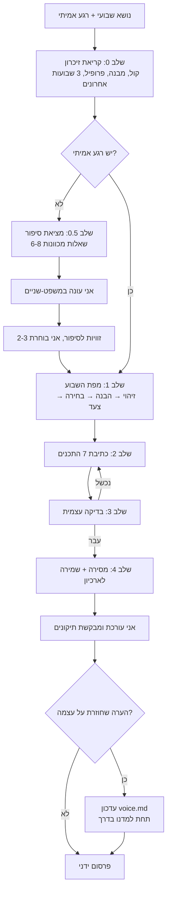
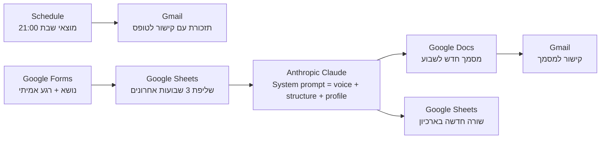

# SPEC - סוכנת התוכן של "בוחרות באומץ"

מסמך תכנון לסוכן AI שמייצר רצף תוכן שבועי לקהילת וואטסאפ של מאמנת מנטלית לנשים.

| | |
|---|---|
| **בעלת המוצר** | אפרת-יערה, מאמנת מנטלית לנשים |
| **סטטוס** | גרסה 1 פועלת (Claude Code), גרסה 2 בתכנון (אוטומציה ב-Make) |
| **תאריך** | אוקטובר 2026 |

---

## 1. הבעיה

אני מנהלת קהילת וואטסאפ חינמית בשם "בוחרות באומץ", לנשים שרוצות שינוי אבל מתקשות לבחור בעצמן ולעשות את הצעד בגלל פחד לאכזב, ריצוי, אשמה או חוסר ביטחון בהחלטות.

כל שבוע אני צריכה לייצר כ-7 תכנים שונים סביב נושא אחד: לקבוצה, לסטטוס, לפייסבוק ולהזמנת חברות חדשות. הבעיות:

- **זמן:** כתיבת 7 תכנים שונים לוקחת שעות.
- **רצף:** קשה לשמור שהתכנים יתחברו זה לזה ויובילו מהזיהוי אל הצעד, ולא יהיו 7 פוסטים נפרדים.
- **קול:** כלי AI כלליים כותבים בשפה "מאמנתית", עם קלישאות העצמה ("את לא לבד", "מגיע לך יותר"), וזה לא הקול שלי.
- **אמת:** כלי AI נוטים להמציא סיפורים אישיים. אצלי כל סיפור חייב להיות אמיתי.
- **חזרות:** אחרי כמה שבועות קל לחזור על אותן פתיחות ושאלות.
- **מעורבות:** בקבוצה מעט מגיבות בכתב. סקרים עובדים טוב יותר ופותחים שיח.

## 2. מטרת הסוכנת

מנושא שבועי אחד ומרגע אמיתי אחד, לייצר רצף שלם של 7 תכנים מוכנים להעתקה, בקול שלי, במבנה קבוע של **זיהוי → הבנה → בחירה → צעד**, בלי להמציא פרטים ובלי לחזור על שבועות קודמים.

### מדדי הצלחה
| מדד | יעד |
|---|---|
| זמן הכנת תוכן שבועי | מכ-3 שעות לפחות מ-45 דקות (כולל עריכה שלי) |
| תכנים שעוברים כמעט בלי שינוי | 5 מתוך 7 |
| פרטים מומצאים | 0 |
| ביטויים אסורים | 0 |
| הצבעות בסקר השבועי | מעקב שבועי, מגמה עולה |
| הודעות בקבוצה אחרי הסקר | מעקב שבועי |
| הצטרפויות חדשות מהודעת ההזמנה | מעקב שבועי |

## 3. היקף

**הסוכנת כן:**
- בונה מפת שבוע (זיהוי, הבנה, בחירה, צעד) מהנושא.
- עוזרת לי למצוא סיפור אמיתי מהחיים בעזרת שאלות מכוונות.
- כותבת 7 תכנים: פתיחת שבוע, סקר מעורבות + הודעת המשך, תוכן מקצועי, סיפור אישי, 3 גרסאות לסטטוס, פוסט לפייסבוק, הודעת הזמנה.
- בודקת את עצמה לפני מסירה (קול, ביטויים אסורים, פרטים מומצאים, אורך).
- שומרת כל שבוע בארכיון ולומדת מהערות שלי.

**הסוכנת לא:**
- **לא מפרסמת בעצמה.** הפרסום בוואטסאפ ובפייסבוק נשאר ידני. זו החלטה מכוונת: כל תוכן עובר את העיניים שלי לפני שהוא יוצא לנשים אמיתיות. בנוסף, ה-API של WhatsApp Business לא תומך בפרסום לקבוצות.
- לא ממציאה סיפורים, אנשים, ציטוטים, מספרים או "מחקרים".
- לא עונה לחברות בקבוצה ולא מנהלת שיחות אימון.
- לא נותנת ייעוץ טיפולי.

## 4. משתמשות

| מי | קשר לסוכנת |
|---|---|
| **אני (המאמנת)** | המשתמשת היחידה. נותנת נושא ורגע אמיתי, עורכת, מאשרת ומפרסמת. |
| **חברות הקבוצה** | קהל היעד של התוכן. אין להן ממשק עם הסוכנת. |
| **קהל חיצוני בפייסבוק** | קהל היעד של הפוסט ושל הודעת ההזמנה. |

## 5. קלט ופלט

### קלט (פעם בשבוע)
| שדה | חובה | דוגמה |
|---|---|---|
| נושא השבוע | כן | גבולות בזוגיות |
| רגע אמיתי | רצוי. אם חסר, הסוכנת עוזרת למצוא | "פעם הייתי אומרת לו בכעס, הפעם באתי בדיבור נעים..." |
| אירוע/מבצע להזמנה | לא | אתגר 5 ימים שמתחיל ב-... |

### פלט
קובץ Markdown אחד לשבוע, שמכיל:

| # | תוכן | שלב בקשת | ערוץ | אורך |
|---|---|---|---|---|
| 0 | מפת השבוע | - | פנימי | 4 שורות |
| 1 | פתיחת שבוע | זיהוי | קבוצה | 50-90 מילים |
| 2 | סקר מעורבות + הודעת המשך | זיהוי → הבנה | קבוצה (סקר וואטסאפ) | שאלה + 3-4 תשובות |
| 3 | תוכן מקצועי + הצעד לשבוע | הבנה | קבוצה | 100-170 מילים |
| 4 | סיפור אישי | הבנה → בחירה | קבוצה | 120-200 מילים |
| 5 | סטטוס (3 גרסאות) | בחירה | סטטוס וואטסאפ | 1-3 שורות |
| 6 | פוסט לפייסבוק | כל הקשת | פייסבוק | 120-200 מילים |
| 7 | הודעת הזמנה לקבוצה | צעד | קבוצות / פרטי | 60-110 מילים |
| - | הערות לפני פרסום | - | פנימי | מה לבדוק, מה חסר |

## 6. איך הסוכנת פועלת



### שלב 0 - קריאת זיכרון
הסוכנת קוראת את קובצי הזיכרון הקבועים (פרק 8) ואת 3 השבועות האחרונים מהארכיון, כדי לא לחזור על פתיחה, שאלה, סיפור או CTA.

### שלב 0.5 - מציאת סיפור
אם אין רגע אמיתי, הסוכנת לא כותבת סיפור. היא שואלת 6-8 שאלות ספציפיות, כל אחת מתחום אחר בחיים (בית ומשפחה, עבודה, חברות, יומיום, "פעם הייתי...", מתאמנת בלי פרטים מזהים, פעם שלא בחרתי באומץ).
לדוגמה: "מתי בפעם האחרונה אמרת כן כשרצית להגיד לא, ומה הרגשת שנייה אחרי?"
מהתשובה שלי היא מציעה 2-3 זוויות לספר את הרגע, ואני בוחרת. אם אני מבקשת להמשיך בלי סיפור, היא כותבת שלד עם `[פרט אמיתי: ...]`.

### שלב 1 - מפת השבוע
4 שורות שכל התכנים נגזרים מהן. זה מה שהופך 7 טקסטים לרצף אחד:
- **זיהוי:** מה היא מרגישה ועושה ביומיום (תסמין מוכר, לא אבחנה).
- **הבנה:** מה קורה מתחת (ריצוי, פחד לאכזב, אשמה, חוסר ביטחון).
- **בחירה:** מה האפשרות האחרת.
- **צעד:** פעולה אחת קטנה וקונקרטית, פחות מ-10 דקות, שאפשר לעשות השבוע.

### שלב 2 - כתיבה
כל תוכן נכתב לפי ההגדרות שלו ב-`structure.md`: מטרה, שלב בקשת, מבנה, אורך.

### שלב 3 - בדיקה עצמית
| בדיקה | כלל |
|---|---|
| אמת | אין אירוע, שם, מספר, ציטוט או תאריך שלא נמסרו |
| ביטויים אסורים | "את לא לבד", "הגיע הזמן לבחור בעצמך", "צאי מאזור הנוחות", "מגיע לך יותר" ודומיהם |
| טון | אין הטפה, אין "את צריכה", אין העצמת כאב כדי למכור |
| אימוג'ים | 0-2 בטקסט קצר, עד 3 בפוסט, לא בכל שורה |
| CTA | עדין: שאלה פתוחה או הזמנה פשוטה |
| צעד | קטן וקונקרטי, לא "תתחילי לבחור בעצמך" |
| אורך | בטווח שהוגדר לכל תוכן |
| רגישות | תוכן אישי רגיש (אבל, משפחה) מסומן בהערה לפני פרסום פומבי |

### שלב 4 - מסירה ושמירה
התכנים מוצגים בצ'אט ונשמרים ל-`weeks/YYYY-MM-DD-<נושא>.md`. בסוף יש רשימה קצרה: מה חסר, ומה כדאי לבדוק לפני פרסום.

## 7. כלים

### גרסה 1 - פועלת היום
| כלי | תפקיד | למה הוא |
|---|---|---|
| **Claude (Opus 5.5)** | המודל שכותב | איכות גבוהה בעברית, עומד בהוראות סגנון מורכבות |
| **Claude Code - Skill** | "המוח" של הסוכנת: הוראות, שלבים וכללים בקובץ `SKILL.md` | נטען אוטומטית כשאני כותבת "נושא השבוע", ומשתמש בקבצים כזיכרון |
| **מערכת קבצים (Read/Write)** | קריאה וכתיבה של קובצי הזיכרון והארכיון | זיכרון שקוף: אני יכולה לפתוח כל קובץ ולתקן אותו בעצמי |
| **Git + GitHub** | גרסאות, גיבוי ושיתוף של ההגדרות | רואים כל שינוי בקול או במבנה לאורך זמן, ואפשר לחזור אחורה |
| **WhatsApp / Facebook** | ערוצי הפרסום | פרסום ידני (ראו פרק 3) |

### גרסה 2 - אוטומציה ב-Make (בתכנון)
המטרה: להפעיל את הסוכנת גם מהטלפון, בלי לפתוח מחשב.



| # | מודול ב-Make | מה הוא עושה |
|---|---|---|
| 1 | **Schedule** | כל מוצאי שבת בשעה קבועה |
| 2 | **Gmail - Send an email** | שולח לי: "מה הנושא השבוע?" עם קישור לטופס |
| 3 | **Google Forms - Watch responses** | טריגר: מילאתי נושא, רגע אמיתי (לא חובה) ואירוע (לא חובה) |
| 4 | **Google Sheets - Search rows** | שולף את 3 השבועות האחרונים מגיליון הארכיון (נושא, פתיחה, שאלת סקר, סיפור) |
| 5 | **Router** | אם אין רגע אמיתי: Claude מייצר רק את שאלות מציאת הסיפור ושולח לי במייל, והתרחיש נעצר. אחרי שאני עונה בטופס, הוא רץ שוב. אם יש רגע: ממשיכים |
| 6 | **Anthropic Claude - Create a prompt** | System prompt: התוכן של `SKILL.md` + `voice.md` + `structure.md` + `profile.md`. User prompt: נושא, רגע, ו-3 השבועות האחרונים. מודל: Sonnet 5.5 (זול יותר לריצה אוטומטית) |
| 7 | **Google Docs - Create a document** | מסמך חדש: "בוחרות באומץ - <תאריך> - <נושא>" |
| 8 | **Google Sheets - Add a row** | שורה לארכיון: תאריך, נושא, רגע, פתיחה, שאלת סקר, קישור למסמך |
| 9 | **Gmail - Send an email** | שולח לי קישור למסמך |

**החלטות תכנון ב-Make:**
- **מקור אמת אחד:** ההוראות נשמרות בריפו. כשמשנים את `voice.md`, מעדכנים גם את ה-System prompt ב-Make. בשלב מתקדם המודול יכול למשוך את הקבצים ישירות מ-GitHub (מודול HTTP ל-raw URL).
- **מפתח API:** נשמר ב-Connection של Make, לא בקוד ולא בריפו.
- **טיפול בשגיאות:** Error handler על מודול Claude: ניסיון חוזר אחד, ואם נכשל, שולח לי מייל "הרצף לא נוצר, נסי שוב".
- **עלות:** ריצה אחת בשבוע, כ-10 פעולות (operations) לריצה. נכנס בתוכנית החינמית של Make.

## 8. ניהול הזיכרון

לסוכנת יש 4 סוגי זיכרון. כולם קבצים פשוטים שאני יכולה לקרוא ולערוך בעצמי. זו החלטה מכוונת: אין "קופסה שחורה".

| סוג | מה נשמר | איפה (גרסה 1) | איפה (גרסה 2 - Make) | מתי נקרא | מי כותב |
|---|---|---|---|---|---|
| **זיכרון זהות (קבוע)** | הקול, הטון, ביטויים אסורים, כללי אימוג'ים | `voice.md` | System prompt | בכל ריצה | אני, והסוכנת בסעיף "למדנו בדרך" |
| **זיכרון מבנה (קבוע)** | 7 התכנים: מטרה, שלב בקשת, אורך, פורמט | `structure.md` | System prompt | בכל ריצה | אני |
| **זיכרון עובדות (קבוע)** | שם, משפט מיצוב, מה יש בקבוצה, קישור, חינמית | `profile.md` | System prompt | בכל ריצה | אני |
| **זיכרון אפיזודי (מצטבר)** | כל שבוע: נושא, רגע, מפה, 7 תכנים | `weeks/*.md` | Google Sheets + Docs | 3 שבועות אחרונים | הסוכנת, אוטומטית |
| **זיכרון עבודה (זמני)** | השיחה של השבוע: תיקונים, בחירות | חלון השיחה | ריצה בודדת | במהלך השבוע | - |

### זיכרון שמתעדכן מעצמו: "למדנו בדרך"
בסוף `voice.md` יש סעיף שבו הסוכנת רושמת הערות סגנון, עם תאריך.

**מתי כותבים לזיכרון:**
- הערה שחוזרת פעמיים או יותר (למשל "פחות ארוך", "בלי שאלות רטוריות").
- הנחיה שנאמרה כחוק ("מעכשיו תמיד...").
- תיקון לעובדה בפרופיל.

**מתי לא כותבים:**
- תיקון חד-פעמי לטקסט מסוים.
- פרטים אישיים מסיפור. הם נשארים בארכיון של אותו שבוע בלבד.

**דוגמאות אמיתיות מהשבוע הראשון:**
- "אימוג'ים מותרים, לא מוגזם ובטוב טעם" עודכן ב-`voice.md` (החליף את הכלל הקודם "בלי אימוג'ים").
- "שאלת מעורבות תמיד כסקר, כי בקבוצה מעט מגיבות בכתב" עודכן ב-`structure.md`.
- "פתיחת שבוע לא תיגמר במשפט מעורפל" עודכן ב-`structure.md`, אחרי שהמשפט "נשארות איתי השבוע?" לא היה ברור.
- "השם בסוף ההודעה, אין פתיחה קבועה" עודכן ב-`profile.md`.

### למה רק 3 שבועות אחרונים?
מספיק כדי למנוע חזרה על פתיחות, שאלות ו-CTA. יותר מזה מנפח את ההקשר ומעלה עלות בלי תועלת אמיתית. נושאים שחוזרים אחרי חודשים זה בסדר, ואפילו רצוי, מזווית אחרת.

### פרטיות בזיכרון
- הארכיון השבועי מכיל סיפורים אישיים ומשפחתיים, ולכן **לא עולה לריפו הציבורי** (מוחרג ב-`.gitignore`).
- הסוכנת לא שומרת פרטים מזהים של מתאמנות.
- כשמופיע תוכן רגיש (אבל, משפחה), הסוכנת מוסיפה הערה לבדוק לפני פרסום פומבי.

## 9. מבנה הריפו

```
.
├── SPEC.md                          ← המסמך הזה
├── README.md                        ← הסבר קצר והפעלה
└── .claude/skills/bocharot-beometz/
    ├── SKILL.md                     ← ההוראות והשלבים של הסוכנת
    ├── voice.md                     ← זיכרון זהות: הקול
    ├── structure.md                 ← זיכרון מבנה: 7 התכנים
    ├── profile.md                   ← זיכרון עובדות
    └── weeks/                       ← זיכרון אפיזודי (מקומי בלבד)
```

## 10. סיכונים ופתרונות

| סיכון | השפעה | פתרון |
|---|---|---|
| הסוכנת ממציאה סיפור או פרט | פגיעה באמינות מול הקהילה | כלל מפורש בכל שלב, `[...]` במקום פרט חסר, בדיקה עצמית, ואני מאשרת לפני כל פרסום |
| הקול "נסחף" לשפה מאמנתית גנרית | התוכן לא נשמע כמוני | רשימת ביטויים אסורים, סעיף "למדנו בדרך", עריכה שלי |
| חזרה על עצמה משבוע לשבוע | הקהילה מאבדת עניין | קריאת 3 השבועות האחרונים |
| תוכן רגיש מתפרסם בפייסבוק | פגיעה בפרטיות של בני משפחה | הערת רגישות בשלב 4 והצעה לניסוח עדין יותר |
| הבטחה בהזמנה שאין לה כיסוי | אכזבה של מצטרפות | ההזמנה מתבססת רק על מה שכתוב ב-`profile.md` |
| שינוי בקול לא מגיע ל-Make | שתי גרסאות לא מסונכרנות | מקור אמת אחד בריפו, ובהמשך משיכה אוטומטית מ-GitHub |
| תקלה ב-Make | אין תוכן לשבוע | Error handler + מייל, ואפשר תמיד להריץ ידנית ב-Claude Code |

## 11. הערכה ובדיקה

- **בכל שבוע:** בדיקה עצמית של הסוכנת (שלב 3), ואחריה עריכה שלי.
- **מעקב שבועי:** כמה תכנים עברו כמעט בלי שינוי, כמה הצבעות היו בסקר, כמה הודעות אחרי הסקר, כמה הצטרפויות.
- **כל חודש:** מעבר על "למדנו בדרך". מאחדים הערות כפולות, וכלל שהתקבע עובר לגוף של `voice.md`.

## 12. שלבי פיתוח

| שלב | מה | סטטוס |
|---|---|---|
| 1 | Skill ב-Claude Code + קובצי זיכרון | הושלם |
| 2 | ריצה ראשונה אמיתית (שבוע "גבולות בזוגיות") ושיפור לפי הערות | הושלם |
| 3 | ריפו ב-GitHub + SPEC | בתהליך |
| 4 | תרחיש Make: טופס → Claude → Google Docs + Sheets + Gmail | מתוכנן |
| 5 | Make מושך את ההוראות ישירות מ-GitHub | מתוכנן |
| 6 | הכנסת תוצאות הסקר לטופס, כדי שהסוכנת תכתוב הודעת המשך מדויקת | רעיון |
